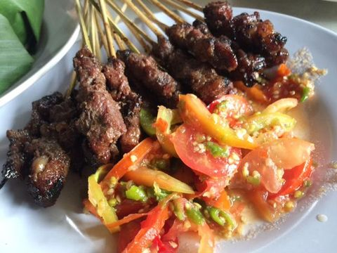
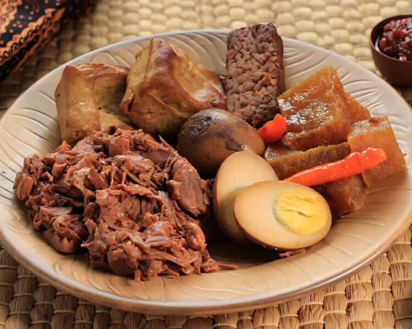
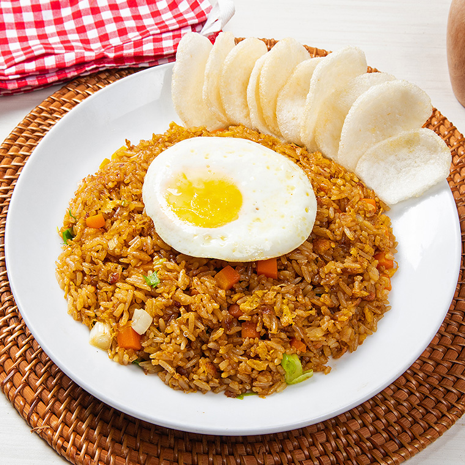
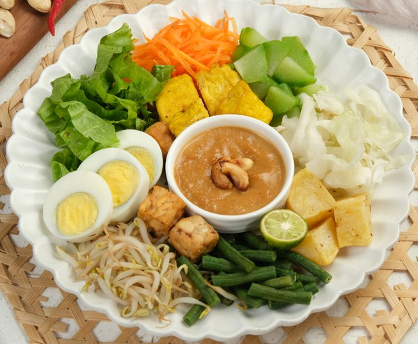
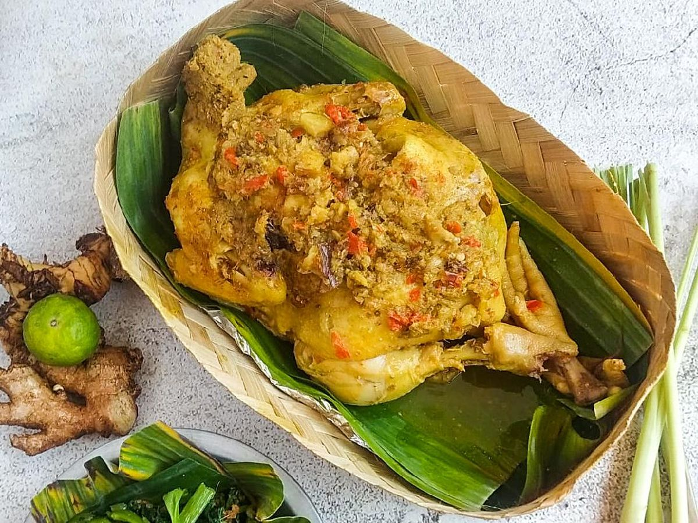
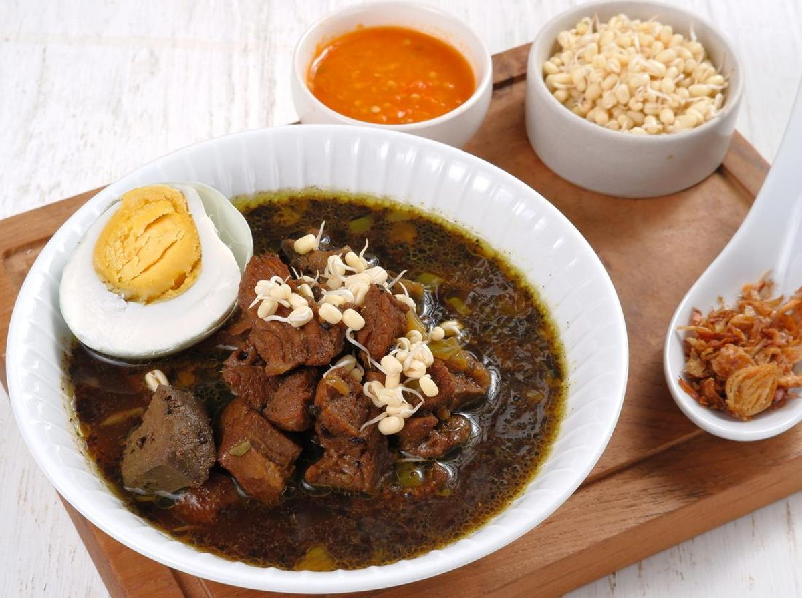

# Culinary Indonesia

## Deskripsi Proyek

Culinary Indonesia adalah aplikasi Android untuk menjelajahi contoh kuliner dari berbagai daerah di Indonesia. Aplikasi ini menyajikan nama, asal, harga, foto, dan deskripsi kuliner dalam satu katalog, sehingga pengguna dapat mencari hidangan dan melihat informasinya tanpa layanan backend.

Data katalog saat ini berupa data contoh yang ditulis di dalam aplikasi. Aplikasi tidak terhubung ke API atau database.

## Fitur Utama

- Menampilkan katalog 12 kuliner Indonesia.
- Mencari kuliner berdasarkan nama; pencarian tidak membedakan huruf besar dan kecil.
- Membuka halaman detail berisi foto, asal, harga, dan deskripsi.
- Menandai atau menghapus tanda favorit, lalu melihat daftar favorit.
- Menampilkan halaman profil pada menu About.
- Menavigasi halaman Home, Favorite, About, dan detail.

Status favorit disimpan di memori selama aplikasi berjalan dan tidak dipertahankan setelah proses aplikasi dimulai ulang. Foto katalog dimuat dari URL, sehingga memerlukan koneksi internet.

## Galeri Kuliner

Berikut beberapa gambar kuliner yang tersedia di repositori:

<table>
  <tr>
    <td align="center"><br>Rendang</td>
    <td align="center"><br>Sate Maranggi</td>
    <td align="center"><br>Gudeg</td>
  </tr>
  <tr>
    <td align="center"><br>Pempek</td>
    <td align="center"><br>Nasi Goreng</td>
    <td align="center"><br>Bakso</td>
  </tr>
  <tr>
    <td align="center"><br>Soto Ayam</td>
    <td align="center"><br>Gado-Gado</td>
    <td align="center"><br>Ayam Betutu</td>
  </tr>
  <tr>
    <td align="center"><br>Papeda</td>
    <td align="center"><br>Rawon</td>
    <td align="center"><br>Lumpia</td>
  </tr>
</table>

Galeri ini menampilkan berkas di direktori `images/`. Aplikasi saat ini memuat gambar katalog dari URL, bukan langsung dari berkas-berkas tersebut.

## Teknologi

- **Bahasa:** Kotlin 1.9.24.
- **Platform dan UI:** Android, Jetpack Compose, Compose Material 3.
- **Navigasi dan state:** Navigation Compose 2.7.7, Lifecycle ViewModel Compose 2.8.2, serta Kotlin Flow.
- **Pemuatan gambar:** Coil Compose 2.6.0.
- **Library Android lainnya:** AndroidX Core KTX, Activity Compose, AppCompat, dan Material Components.
- **Build:** Android Gradle Plugin 8.5.0 dan Gradle Wrapper 9.5.0.
- **Pengujian:** JUnit 4, AndroidX JUnit, Espresso, dan Compose UI Test.
- **Database/backend:** Tidak digunakan. Data kuliner berada di kode sumber dan dikelola di memori.

## Struktur Direktori

```text
.
├── app/
│   ├── build.gradle.kts            # Konfigurasi modul aplikasi dan dependensi
│   └── src/
│       ├── main/
│       │   ├── AndroidManifest.xml # Konfigurasi aplikasi dan izin internet
│       │   ├── java/.../
│       │   │   ├── MainActivity.kt # Titik masuk antarmuka aplikasi
│       │   │   ├── data/           # Data contoh dan repository
│       │   │   ├── di/             # Penyedia repository
│       │   │   ├── model/          # Model Culinary
│       │   │   └── ui/             # Compose UI, navigasi, ViewModel, dan tema
│       │   └── res/                # Resource Android, ikon, dan tema
│       ├── test/                   # Pengujian unit lokal
│       └── androidTest/            # Pengujian instrumentasi dan UI Compose
├── gradle/
│   ├── libs.versions.toml          # Versi plugin dan library
│   └── wrapper/                    # Distribusi Gradle Wrapper
├── images/                         # Berkas gambar kuliner di repositori
├── build.gradle.kts                # Konfigurasi Gradle tingkat proyek
├── gradle.properties               # Pengaturan Gradle dan AndroidX
├── settings.gradle.kts              # Nama proyek dan modul Gradle
├── gradlew                          # Gradle Wrapper untuk Linux/macOS
├── gradlew.bat                      # Gradle Wrapper untuk Windows
└── LICENSE                          # Lisensi proyek
```

Daftar kuliner dan URL foto didefinisikan di `app/src/main/java/com/dicoding/rnlkav_jetpack/data/CulinaryDataSource.kt`. Walaupun direktori `images/` berisi berkas gambar, implementasi katalog saat ini memuat foto melalui URL.

## Prasyarat dan Instalasi

- Android Studio dengan dukungan Android Gradle Plugin yang digunakan proyek.
- Android SDK Platform 35 dan SDK Build-Tools yang sesuai.
- JDK 25 untuk Gradle daemon sesuai konfigurasi toolchain proyek. Kode dikompilasi dengan target JVM 11.
- Emulator Android atau perangkat Android dengan API 24 (Android 7.0) atau lebih baru untuk menjalankan aplikasi.
- Koneksi internet untuk sinkronisasi dependensi Gradle dan memuat foto dari URL.

Untuk menyiapkan proyek:

1. Buka direktori proyek di Android Studio.
2. Pastikan Android SDK Platform 35 dan JDK yang diperlukan tersedia.
3. Sinkronkan proyek Gradle agar Gradle Wrapper mengunduh dependensi yang belum tersedia.
4. Pilih emulator atau perangkat Android sebagai target.

Tidak diperlukan berkas konfigurasi rahasia atau konfigurasi backend khusus.

## Cara Menjalankan

Dari direktori root proyek, buat APK debug dengan:

```bash
./gradlew assembleDebug
```

Untuk memasang aplikasi pada emulator atau perangkat yang terhubung dan sudah diotorisasi:

```bash
./gradlew installDebug
```

Setelah pemasangan, buka **Culinary Indonesia** melalui launcher perangkat. Alternatifnya, buka proyek di Android Studio, pilih konfigurasi aplikasi, lalu jalankan pada emulator atau perangkat.

Di Windows, gunakan `gradlew.bat` sebagai pengganti `./gradlew`.

## Penggunaan

1. Buka tab **Home** untuk melihat daftar kuliner.
2. Ketik nama kuliner pada kolom pencarian untuk menyaring daftar. Hapus teks pencarian untuk melihat semua data lagi.
3. Pilih item untuk membuka detail kuliner.
4. Tekan ikon hati pada halaman detail untuk menambah atau menghapus kuliner dari favorit.
5. Buka tab **Favorite** untuk melihat kuliner yang ditandai. Daftar ini kosong jika belum ada favorit.
6. Pilih tab **About** atau ikon profil untuk melihat halaman profil.

Aplikasi ini tidak menyediakan endpoint API publik maupun layanan backend.

## Pengujian

Jalankan pengujian unit lokal dengan:

```bash
./gradlew testDebugUnitTest
```

Jalankan pengujian instrumentasi dan UI Compose dengan emulator atau perangkat yang terhubung:

```bash
./gradlew connectedDebugAndroidTest
```

Pengujian UI mencakup tampilan awal, navigasi ke detail, perubahan favorit, pencarian, dan halaman About.

## Informasi Tambahan

### Troubleshooting

- Jika sinkronisasi atau build gagal, periksa JDK yang digunakan Gradle, ketersediaan Android SDK Platform 35, serta kompatibilitas versi Gradle Wrapper dan Android Gradle Plugin.
- Jika pemasangan gagal, pastikan emulator atau perangkat aktif, terdeteksi oleh Android Studio/ADB, dan telah mengizinkan debugging USB jika diperlukan.
- Jika foto tidak muncul, periksa koneksi internet. Katalog mengambil gambar dari URL dan tidak mengandalkan salinan lokal di direktori `images/`.
